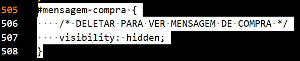

# Projeto 1 Frontend
## Aluno: Gabriel Rocha Flores
### Descrição da loja
Para este trabalho foi escolhido fazer um site de um supermercado. O site conta com uma pagina inicial, de cadastro, de login, uma loja com carrinho e filtros de pesquisa, uma pagina de perfil com uma tabela de ultimas compras e uma pagina de relatorios com tabelas de clientes cadastrados e compras feitas no site com ambas as tabelas tendo uma area de pesquisa com seletor de qual informação será pesquisada
### Navegando pelo Site
Em todas as paginas do site você encontrara uma barra amarela no topo da pagina para navegação no site


Ao clicar na logo do supermercado no canto superior esquerdo da pagina voce ira parar na pagina inicial(index.html)


No canto superior direito da pagina se encontra os links para as outras paginas


O primeiro link da esquerda para direita leva para a pagina de cadastro(cadastro.html)


O segundo leva para a pagina de login(login.html)


O terceiro leva para a pagina de perfil(perfil.html)


O quarto leva para a pagina da loja(loja.html)


E o quinto e ultimo leva para a pagina de relatórios(relatorios.html)

### Visualizar Mensagem de compra
No arquivo Stylesheet.css dentro da pasta CSS apague a area da linha 505 a 508 destacado na seguinte imagem




### Validações
validação cadastro.html

validação Impressão.css

validação index.html

validação login.html

validação loja.html

validação perfil.html

validação relatórios.html

validação Stylesheet.css


### Estrutura de pasta
```shell
  .
  ├── CSS
  │   ├── Impressao.css
  │   └── Stylesheet.css
  ├── imagens
  │   ├── icones
  │   │   ├── carrinhoDeCompras.png
  │   │   ├── lupa.png
  │   │   ├── perfil-de-usuario.png
  │   │   └── tabela.png
  │   ├── Produtos
  │   │   ├── alcatra.png
  │   │   ├── Arroz.png
  │   │   ├── batata.png
  │   │   ├── detergente.png
  │   │   ├── feijao.png
  │   │   ├── leite.png
  │   │   ├── manteiga.png
  │   │   ├── ovos.png
  │   │   ├── patinho.png
  │   │   ├── sabaoEmPo.png
  │   │   └── tomate.png
  │   └── variados
  │       ├── PreçoBaixoTodoDia.png
  │       ├── super-shoe-supermercados-seeklogo.png
  │       └── supermercado.png
  ├── printsValidação
  │       ├── validação-cadastro.html.png
  │       ├── validação-Impressao.css.png
  │       ├── validação-index.html.png
  │       ├── validação-login.html.png
  │       ├── validação-loja.html.png
  │       ├── validação-perfil.html.png
  │       ├── validação-relatorios.html.png
  │       └── validação-Stylesheet.css.png
  ├── imagensREADME
  ├── cadastro.html
  ├── index.html
  ├── login.html
  ├── loja.html
  ├── perfil.html
  ├── README.md
  └── relatorios.html
```
